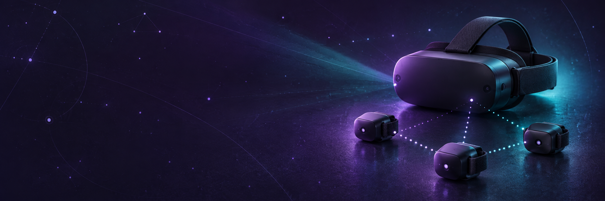
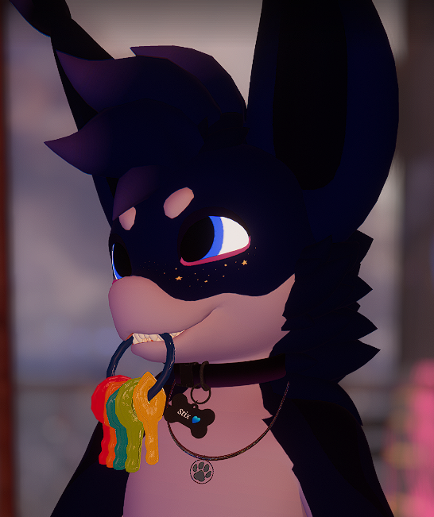

<p align="center"></p>

<h1 align="center">FramePicoTracker</h1>
<p align="center">An open research handoff for affordable PICO Swift body tracking on Steam Frame.</p>
<p align="center"><strong>Research prototype · Community continuation welcome · Full body tracking is not working yet</strong></p>
<p align="center"><a href="QUICK_SETUP.md">Start here</a> · <a href="docs/PUBLIC_STATUS.md">Current status</a> · <a href="docs/RESEARCH_TREE.md">Research map</a> · <a href="CONTRIBUTING.md">Continue the work</a> · <a href="CREDITS.md">Credits</a></p>

## Why this exists

PICO Swift trackers are relatively inexpensive. I wanted to make them useful for body tracking on Steam Frame through its onboard Roy radio, without an external receiver or a PICO headset acting as a live bridge. The eventual target is waist and both legs, together with the normal controllers, for applications such as VRChat.

This repository brings together the implementation, the research history, negative results, exact firmware changes and instructions that another developer needs to pick up the work. It is a starting point for developers, not something you can install today to get working full body tracking.

## Where the project stands

**Publication snapshot: October 15, 2026.** These are saved results, not a new check of the devices on publication day.

| Area | What the evidence supports |
| --- | --- |
| Frame app and diagnostics | Native dashboard, Game and Service choices, diagnostic API and guarded session control are implemented. |
| Onboard Roy radio | A bounded 150 second test confirmed fresh Game mode replies from one tracker. The test ended with all four recorded restoration checks passing. |
| Tracker firmware work | The protected diagnostic10 candidate has an exact stock reference. This repository distributes changes as diffs, never a stock or patched image. |
| Roy RAM modules | Game and service source variants are included. They use temporary SRAM and depend on a specific stock Roy build. Their validation status differs. |
| IMU and optical research | Earlier pilots received real IMU data and published sparse optical measurements under their own conditions. That is useful evidence, but it is not stable current tracking. |
| Latest passive optical probe | 900 stereo pairs produced zero accepted fits. Too few consistent markers were detected in the short exposure data. |
| Full body tracking | Not achieved. Stable current optical identity, calibrated optical and IMU fusion, three tracker roles and reliable controller coexistence remain open. |

There is no honest completion percentage. Several essential steps still need measured proof. This is beyond a protocol sketch, but it is still several major milestones away from a usable full body tracking system. See [the detailed status and milestones](docs/PUBLIC_STATUS.md).

**Game and Service:** Service supports tracker maintenance and OTA with the controllers powered off, reducing competition for the shared Roy radio. Game remotely requests mode1 on compatible custom tracker firmware and checks the actual applied state. Mode1 changes operating cadence; it does not by itself prove LED and camera phase synchronization or working controller coexistence. [Exact mode contracts](docs/ROY_AND_COEXISTENCE.md).

## Start here

1. Read [QUICK_SETUP.md](QUICK_SETUP.md). It separates what is included from the source, assets and configuration you still need.
2. Read [CURRENT_STATE.md](docs/CURRENT_STATE.md), [RESEARCH_TREE.md](docs/RESEARCH_TREE.md) and [SUPERSESSION.md](docs/SUPERSESSION.md). Later summaries do not erase earlier experiments.
3. Check the package offline with Python 3.12 or newer:

   ```text
   python tools/verify_package.py
   python tools/query_catalog.py knowledge --contains optics --limit 20
   ```

4. Read [the source supplement guide](source/README.md) and copy `source/` into a separate development checkout. Obtain dependencies and your own calibration as described in [ACQUISITION.md](docs/ACQUISITION.md).
5. Pick one blocker from [CONTRIBUTION_TASKS.md](docs/CONTRIBUTION_TASKS.md). Keep your observations and limitations in the same change.

If you are using an AI assistant, start with [AI_START_PROMPT.md](AI_START_PROMPT.md) and [AGENTS.md](AGENTS.md). Use the catalogs to retrieve relevant history instead of guessing from one summary.

## What is in the repository

| Path | Contents |
| --- | --- |
| `source/pc/frame_app/` | Our native dashboard and device monitors. Upstream overlay code is acquired separately. |
| `source/pc/radio/` | Protocol, diagnostics, session control and tracker firmware tooling. |
| `source/pc/radio/ram/` | Roy game and service modules, loader, runtime and recovery logic. |
| `source/historical-original210/` | The protected historical Roy source, separate from newer copies. |
| `source/pc/optical/` | Camera timing, marker association, geometry, calibration interfaces and fusion research. |
| `source/pc/driver/` | Pose transport and native SteamVR driver source. |
| `docs/` | Current evidence, interfaces, acquisition instructions and continuation plans. |
| `research/` | English history ledger and source cards covering 768 discovered Markdown versions. |
| `catalog/` | Searchable source, asset, document and research graph metadata. |
| `firmware-diffs/` | 24 exact stock relative differences and their provenance. |
| `tools/` | Offline package checks, catalog queries and diff verification. |
| `verification/` | Hash manifests, review findings, exclusions and validation limits. |

There are 135 selected source files. Private calibration values were removed, personal device identifiers were replaced, and three legacy C candidates deliberately refuse compilation until their identity configuration is reviewed. Historical tests with unreviewed recorded fixtures are listed exclusions. This is not a fully reproducible build environment or a turnkey release.

No PICO or Valve firmware images, SDKs, native vendor libraries, decompilations, private calibration, raw captures or credentials are included. You obtain permitted copies of the necessary external inputs yourself. Firmware diffs require the exact matching stock image. Instructions and old experiments do not authorize a new hardware operation.

## A note from me



I cannot continue the work right now. My health has become much worse, and I currently do not have access to the medication I need.

I am sharing what I have so the research does not disappear with my ability to work on it. I hope the community can take it further and make this technology useful to people who cannot afford an expensive tracking setup. These trackers are cheap enough to make that worth trying.

If you continue it, please keep the history and credit, be honest about what works, and leave the next person better notes than you started with. I may not be able to reply quickly or provide ongoing support.

**L8OLOOE** · [GitHub](https://github.com/Rulez777) · [X](https://x.com/L8OLOOE) · [VRChat](https://vrchat.com/home/user/usr_937434c0-4a82-46bb-9457-f21cfa31ad6c)

<br clear="right">

## Thanks

Thanks to [Hinata Reira](https://x.com/hinata_reira) for encouragement and the packet reference `pico_tracker_packets_en.md`. It helped with cross checking IMU packet layout, conversion scales and timing behavior. This was a focused reference contribution; the Frame implementation and its experimental results are separate work. [Specific credit and evidence boundaries](CREDITS.md).

## License and credit

Project authored code and original documentation are released under [GNU GPL version 3 or later](LICENSE), with scope and exceptions in [NOTICE.md](NOTICE.md). Keep copyright and license notices, credit existing contributors and identify your changes. The GPL preserves those notices and keeps distributed derivative code under its terms. It cannot physically prevent someone from misrepresenting authorship.

The avatar screenshot and third party material are outside that license grant. Product names identify compatibility targets and imply no endorsement. The banner is an AI generated illustration, not a photograph or evidence of a completed device.
