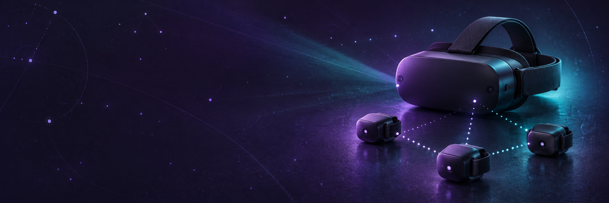

# FramePicoTracker

**Connect PICO Swift motion trackers directly to Steam Frame.**

FramePicoTracker brings tracker data into SteamVR using the headset's built-in radio. The project includes a headset app, a Windows firmware builder, and a bridge for sending tracker poses to PC SteamVR.

[**Quick Start**](START_HERE.md#quick-start) · [**Firmware Builder**](launcher/README.md) · [**Contribute**](#contribute)

## Project demo

*Visualization of recorded tracker poses from the early r14b prototype, well before Alpha 1.3.*

## What we've built

| | |
| --- | --- |
| **Direct radio link** | A live PICO Swift tracker sent IMU, magnetometer, and battery data through Steam Frame's built-in Roy radio. IMU data reached the SteamVR driver. |
| **Headset controls** | Start single- or multi-tracker sessions from FramePicoTracker in the SteamVR dashboard. |
| **Verified firmware builds** | The Windows builder downloads FW189, rebuilds Alpha 1.3, and verifies that the result matches the reference SHA-256. It also accepts custom manifests. |
| **PC SteamVR bridge** | A Frame sender and Windows driver carry tracker poses over UDP. The bridge passed local loopback tests. |

## Contribute

Have a Steam Frame and PICO Swift trackers? Hardware test reports help establish how the setup behaves across devices. Include your SteamVR version, tracker firmware, and the result of a short session.

If you'd rather work on code, there are entry points for camera tracking, sensor fusion, radio timing, and the Windows bridge. Start with the [development guide](START_HERE.md#development), then [open an issue](https://github.com/Rulez777/FramePicoTracker/issues/new) to share a test result or discuss a change.
