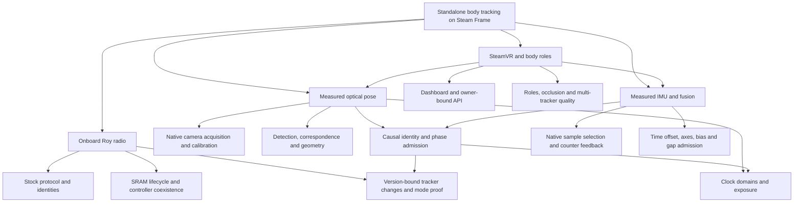

# Research tree and dependencies

## Historical branches

1. **Official SDK/PC bridge:** PICO Unity SDK→TCP→PC→VMT. Useful coordinate/protocol reference, but a different architecture; it does not satisfy onboard standalone operation.
2. **Passive stock-radio research:** packet shape, CRC, whitening/address reconstruction, full identity provenance, channels, bootstrap/personal addressing and reconnect persistence. Early silence was a low-coverage negative, not device absence.
3. **Temporary Roy station:** bounded SRAM receiver, active negotiation, three-peer captures, continuous-service/controller regression, MPSL request/overstay issues, TX timing and safe teardown.
4. **FW189 experiments:** exact stock container/application identity; grid-only patch; dual-mode startup/mode query; revisions07–11, observer schemas and guarded OTA/activation. Installed diagnostic10 is the protected branch; candidate11 is not installed proof.
5. **Mode and sample gates:** nonce-correlated native applied-mode/N/pending state; native sensor initialization/state32/upstream gates; command19 admission; finite mode lease and ACK retirement.
6. **Camera acquisition:** OCC/native recording, exact H264 packet timestamps, serial-bound active calibration, KB projection, HEAD/CAD/world transforms, RAW/MONO/BOOTTIME distinction and per-boot clock evidence.
7. **Optical identification:** LED constellations, native-derived contrast/contour findings, P3P/root ambiguity, stereo correspondence, triangulated hints, unchanged refinement/covariance gates and causal dark/lit evidence.
8. **IMU delivery/fusion:** native ring selection, command11 feedback, measured sample counter period, physical time offset/axis/bias calibration, no interpolation across missing measurements.
9. **Three-peer RAM/body branch:** deferred state islands and owned DMA layout, fixed MPU/code budgets, mailbox code hazards, native body-pose interface investigation; no shipped vendor model/library and no demonstrated full body.
10. **App and pilot lifecycle:** native dashboard Game/Service modes, owner-specific stream routing, sealed profiles, preflight executable checks, actual393-v2 mode proof, optical latency/profile probes and continued strict pose invalidation.

`catalog/RESEARCH_GRAPH.json` supplies machine-readable nodes and evidence edges. `research/INDEX.md` contains the deduplicated narrative ledger. `catalog/RESEARCH_DOCUMENTS.json` accounts for every discovered Markdown version, including historical backups. A later node corrects a specific claim; it does not delete the experiment that produced it.
